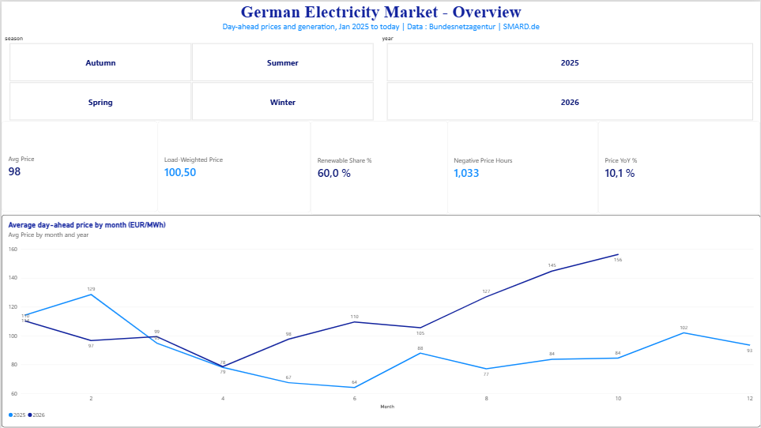
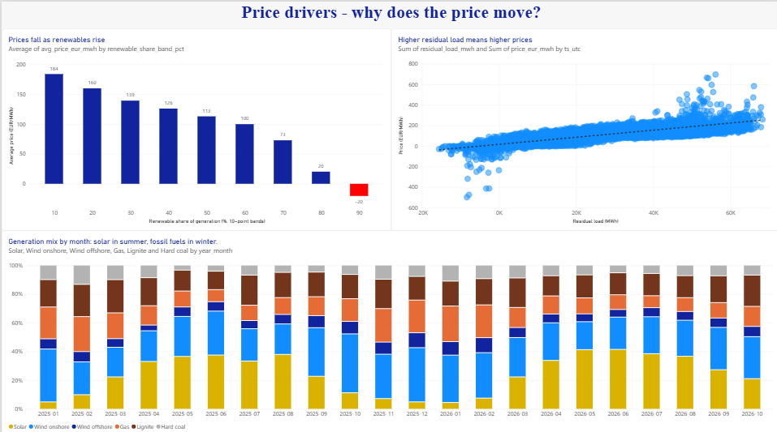
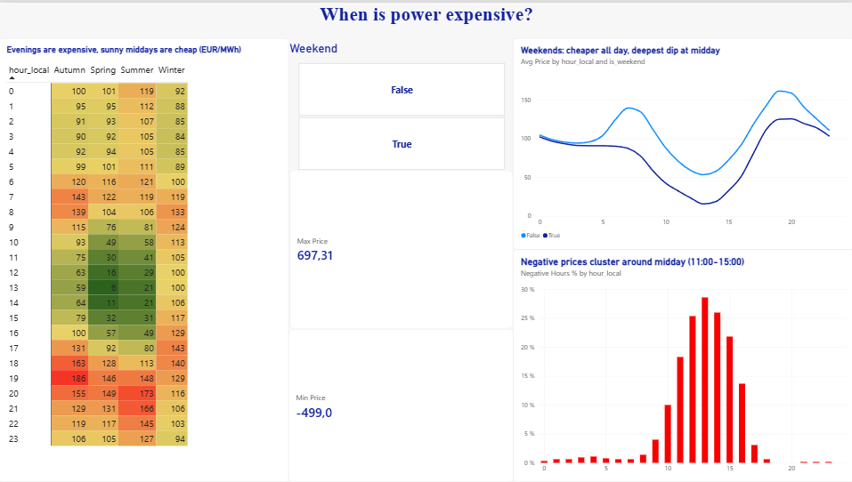

# German Electricity Market Pipeline (SMARD)

End-to-end analytics pipeline on official German power-market data from
[SMARD.de](https://www.smard.de) (Bundesnetzagentur): hourly day-ahead prices,
generation by source and consumption, **refreshed automatically every day**.

**Stack:** Python → Google BigQuery → dbt (staging → star schema, data tests) → Power BI · scheduled with GitHub Actions

## Business questions
1. **How does the renewable share move wholesale prices?** (merit-order effect)
2. **When are the expensive hours**, by season and weekday/weekend?
3. **How often do prices go negative**, and at what time of day?

## Key findings (Jan 2025 – Oct 2026)
- **Renewables push prices down, and the effect gets stronger as the share rises.** In hours where renewables made up
  10–20% of generation, the average price was **€184/MWh**. At 90%+ it was **−€20/MWh**. The steepest
  drop comes above 70% (€73 → €20 → −€20). That is the merit-order effect: wind and solar have near-zero marginal cost and push gas plants out of the market.
- **Timing matters more than season.** Autumn evenings at 19:00 average **€186/MWh**, while spring middays at
  13:00 average **€6/MWh**. The evening peak (18:00–20:00) shows up in every season. Sunny middays are the cheapest hours of the year.
- **Negative prices are a midday solar phenomenon.** About **29% of all 13:00 hours** had a negative price,
  compared with almost none between 18:00 and 08:00. Total: **1,033 negative-price hours** since Jan 2025.
- **Weekends are cheaper, especially at midday.** With lower demand and the same solar output, the weekend midday price
  falls to about **€15/MWh**, compared with about **€55/MWh** on weekdays.
- **2026 is more expensive than 2025.** From May onwards, every month of 2026 was priced above the same month of 2025
  (e.g. September **€145** vs **€84**).
- **Extremes:** highest price **€697.31/MWh** (14 Sep 2026, 19:00). Lowest **−€499/MWh** (1 May 2026, a public holiday with low demand and high solar).
- **Consumers pay more than the simple average suggests.** The load-weighted price (**€100.50**) is above the plain
  average (**€98**), because high-demand hours are also the expensive ones.

## Dashboard
**1. Overview:** KPIs and monthly price trend 2025 vs 2026


**2. Price drivers:** merit-order effect, residual load vs price, generation mix by month


**3. When is power expensive:** hour × season heatmap, weekday vs weekend, negative-price hours


## Architecture
```
SMARD API ──► ingest/smard_ingest.py ──► BigQuery smard_raw.energy_hourly (append-only, clustered)
                                              │
                                     dbt  stg_energy_hourly   (dedup, Berlin local time, tests)
                                              │
                         fct_energy_hourly · dim_date · mart_price_by_renewable_band · mart_hourly_price_profile
                                              │
                                     Power BI (import mode, star schema, DAX measures)

GitHub Actions: daily 06:17 UTC → ingest last 3 days → dbt build (models + tests)
```

## Data
15 SMARD series (filter IDs in `ingest/smard_ingest.py`): day-ahead price (4169),
total load (410), residual load (4359), and generation by source (solar, wind
on/offshore, biomass, hydro, lignite, hard coal, gas, pumped storage, nuclear, other).
Data comes from SMARD's public JSON endpoints. No scraping, no API key.

## Data model
- **`stg_energy_hourly`** (view): deduplicates re-loaded hours, converts UTC to Europe/Berlin.
- **`fct_energy_hourly`** (table): one row per hour, with series pivoted to columns and derived fields
  (`renewable_share`, `is_negative_price`, `est_wholesale_cost_eur`).
- **`dim_date`**: calendar with season and weekend flag, joined 1 → * on `date_local`.
- **Marts:** price by 10-point renewable-share band, and an hourly price profile by season and day type.
- **Tests:** unique (series, hour) and not-null values, run on every `dbt build`.

## Power BI
- Star schema with a separate date dimension; Auto date/time disabled.
- Explicit DAX measures (no implicit sums): `Avg Price`, `Load-Weighted Price` (SUMX),
  `Renewable Share %`, `Negative Price Hours`, `Negative Hours %`, `Price YoY %` (SAMEPERIODLASTYEAR), `Max/Min Price`.
- Interactions tuned with *Edit interactions*, so comparison charts keep both series when a slicer is used.

## Run it
```bash
pip install -r requirements.txt
python ingest/smard_ingest.py --start 2025-01-01                 # local Parquet only
export GCP_PROJECT_ID=... GOOGLE_APPLICATION_CREDENTIALS=gcp-key.json
python ingest/smard_ingest.py --start 2025-01-01 --bigquery      # backfill into BigQuery
cd dbt && dbt deps && dbt build --profiles-dir .
```
The daily GitHub Actions workflow needs two repository secrets: `GCP_PROJECT_ID` and `GCP_SA_KEY`.

## Design decisions
- **Long-format raw table, append-only.** Re-runs never lose data. Deduplication lives in dbt
  (`row_number()` over `loaded_at`), so ingestion stays simple and idempotent.
- **3-day rolling window** on daily runs picks up SMARD's late corrections.
- **Time zones:** stored in UTC, reported in Europe/Berlin, so DST days don't break the hourly profiles.
- **Least-privilege service account** (BigQuery Data Editor + Job User only); the key is kept out of Git.
- **Resilient ingestion:** retries with exponential backoff, and one failing series doesn't stop the run.

## Possible next steps
- Add an `accepted_range` test (renewable share between 0 and 1).
- Forecast next-day prices from load and renewable forecasts (SMARD also publishes forecasts).
